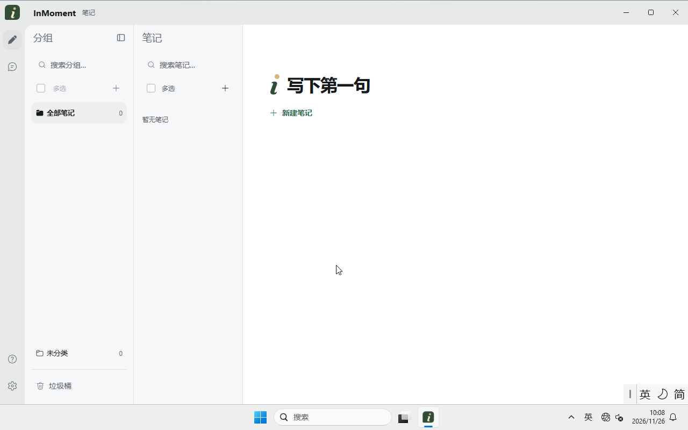

# InMoment

**Capture a thought in context. Turn it into a note, discuss it with AI, or share it with its sources.**

[简体中文](README.md) · [User guide, Chinese](docs/USER_GUIDE.md) · [1.0.0 release notes, Chinese](docs/releases/1.0.0.md) · [Changelog](CHANGELOG.md) · [Product decisions](docs/product/PRODUCT_STORY.md)

[](https://ienqi.github.io/InMoment/)

InMoment is a local-first Windows desktop app that brings recordings, screenshots, and source context into editable notes. Write a note directly or speak a thought while reading or working. Search, group, and export your notes, or bring notes and files into a chat and save useful exchanges back to the library.



*The first screenshot shows 1.0.0 running after installation in a Windows 11 VM. The examples below use synthetic notes and prepared AI responses. [Release verification](docs/releases/READINESS.md) · [Example provenance](docs/assets/releases/v0.14.31/PROVENANCE.json)*

## Capture and organize

- **Speak the thought.** By default, hold the right mouse button to start recording. Release to expand the card and keep recording hands-free. Use the left control to pause or resume. Keep text, audio, or both when saving, and choose whether to append to an existing note.
- **Capture a region.** Click the scissors on the recording card to select, annotate, and attach a screenshot while recording continues. Press `Alt+Shift+Q` to select text in the current window and ask AI.
- **Work in one library.** Handwritten notes save automatically. Recording and chat notes appear in the same library. Organize notes into groups, add links and files, or export notes as PDF or Markdown with their supporting attachments.
- **Extract text from images.** Recognize text from a whole image or a selected region in note and chat image previews. OCR runs locally; copy the result or insert it into the note when working in the editor.


## Discuss your sources

Reference notes or attach PDFs, UTF-8 text, MP4 clips, and images in one message. Math renders locally. Use the side navigation to jump between questions. Save a conversation or selected messages as a note, save them as attachments to referenced notes, or append them to an existing note.


Choose DeepSeek, OpenAI (GPT), or Google Gemini for cloud AI. Select a chat model and reasoning level or let InMoment choose. Generate editable notes with text and images from summaries, and preview rewrites before applying them to selected text.

## Download and run

The current stable version is **1.0.0** for **Windows 11 x64**. Choose the Windows download button on the official page. The version and SHA-256 checksum are listed on the same page. [InMoment download page](https://ienqi.github.io/InMoment/)

1. Open the installer and choose an installation folder in the wizard.
2. Open InMoment from the Start menu after setup. Before an upgrade or reinstall, exit InMoment from the system tray. Your Windows profile retains the existing settings, notes, and attachments.
3. Grant microphone permission to record, or create a note directly. The full package includes offline transcription, a local semantic model, and image OCR. Everyday local features require no API key or separate Node.js, pnpm, or Python installation.
4. For cloud AI, open Settings → AI Services, enter a key for your chosen provider, and enable the permissions you need. Capabilities, quotas, and charges depend on your service account. See [AI service setup](docs/AI_PROVIDER_SETUP.md).


| Task | Where it runs and what it needs |
| --- | --- |
| Notes, recording, playback, transcription, keyword search, image OCR, PDF or Markdown export | On your device; recording and screenshots require applicable system permissions |
| Chat, summaries, rewrites and AI grouping suggestions | Network access, an API key for the selected provider, and your consent |
| PDF, text, video and image attachments in chat | Provider support is required. Gemini can receive original PDFs and MP4s, and GPT can receive original PDFs. DeepSeek receives locally extracted PDF text and sampled page images |
| MP4 analysis with GPT or DeepSeek | Local frame sampling and transcription require external `ffmpeg.exe` and `ffprobe.exe`. Put them in `chat-media/bin/` next to the app, or on PATH. Gemini's original-video route does not need them |

See [release verification](docs/releases/READINESS.md) for the 1.0.0 download, upgrade, and launch results.

## Your data, upgrades and versions

Notes, audio, screenshots, and attachments stay in the current Windows user's application-data directory. Cloud AI starts disabled, and sending screenshots with AI organization requires separate consent. Original recordings stay on your device. The chosen provider handles chat attachments you send. Windows DPAPI protects API keys. The library and media rely on Windows file permissions. [Privacy notice](https://ienqi.github.io/InMoment/privacy.html) · [Security notes](SECURITY.md)

To upgrade, quit from the tray and back up `%APPDATA%\InMoment`, then run the new installer. Use a separate data directory when evaluating an older version. See the [version inventory](docs/releases/VERSIONS.md). The [0.14.16 notes](docs/releases/0.14.16.md), [original animation](docs/assets/workflow.gif), and [silent demo](docs/assets/inmoment-demo-silent.mp4) document earlier versions.

## Development and validation

InMoment began with the author's own note-taking workflow. The [product decisions](docs/product/PRODUCT_STORY.md) document requirements, interaction design, and AI workflows. Automated checks use synthetic data and mocked responses. See the [validation log](docs/validation.md) for previous results.

Development requires Windows 11 x64, Node.js 24+, and pnpm 11.25.0:

```powershell
pnpm install --frozen-lockfile
pnpm native:build
pnpm check
pnpm test
pnpm start
```

See the [development guide](docs/DEVELOPMENT.md) for model preparation, isolated checks, and packaging. The source is [MIT licensed](LICENSE); bundled components retain their [own licenses](THIRD_PARTY_NOTICES.md).
