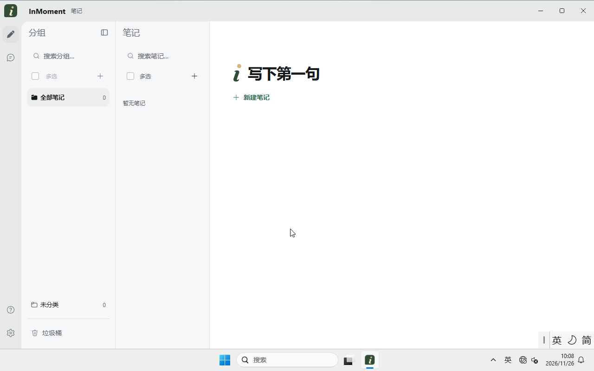

# InMoment · 灵感现场

**先把想法留下，再写成笔记、带进聊天，或和资料一起归档。**

[English](README.en.md) · [使用指南](docs/USER_GUIDE.md) · [1.0.0 更新说明](docs/releases/1.0.0.md) · [完整更新记录](CHANGELOG.md) · [产品设计](docs/product/PRODUCT_STORY.md)

[](https://ienqi.github.io/InMoment/)

InMoment 是一个本地优先的 Windows 桌面工具，把当下的录音、截图和来源整理到可编辑的笔记中。你可以随手写一条，也可以在阅读或工作时说下来，再搜索、分组或导出。想继续讨论时，将笔记、图片和文件带进聊天，最后把有用的回答存回笔记。



*首图来自 1.0.0 在 Windows 11 虚拟机中的实装。下方功能示例使用合成内容和预置 AI 结果。 [发布验证](docs/releases/READINESS.md) · [示例来源](docs/assets/releases/v0.14.31/PROVENANCE.json)*

## 从灵感到笔记

- **说下来。** 默认长按右键开始录音，松开时展开卡片并继续当前这段。用左侧图标暂停或继续。保存时可选择保留文字、录音或两者，也可以追加到已有笔记。
- **圈出现场。** 点击录音卡片的剪刀图标，框选、标注并将截图加入当前草稿。录音可以继续。按 `Alt+Shift+Q` 可在当前窗口划词问 AI。
- **整理为可分享的笔记。** 手写笔记自动保存，录音笔记和聊天笔记也在同一个列表。支持分组、图片、链接及文件，可导出为 PDF 或 Markdown，并另存相关附件。
- **提取图片里的文字。** 在笔记或聊天图片中按需提取全图或指定区域的文字。识别在本机运行，结果可复制；在笔记中也可直接插入正文。


## 带着资料继续讨论

在聊天中引用笔记，或一同添加 PDF、UTF-8 文本、MP4 和图片。公式在本地排版，侧边短线按提问跳转。整段聊天和选中的消息可以存成笔记、存为引用笔记的附件，或追加到已有笔记。


云端服务可选 DeepSeek、OpenAI（GPT）或 Google Gemini。聊天可自动选模型，也可手动指定模型和推理强度。一键总结可以生成可编辑的图文笔记。选段改写可先预览，确认后写回正文。

## 下载与开始使用

当前稳定版为 **1.0.0**，适用于 **Windows 11 x64**。在官方下载页点击「下载 Windows 版」。版本和 SHA-256 校验文件也在同一页面。 [InMoment 下载页](https://ienqi.github.io/InMoment/)

1. 双击安装包，在向导里选择程序的安装目录。
2. 安装完成后，从开始菜单打开 InMoment。升级或重装前先从系统托盘退出 InMoment，已有设置、笔记和附件留在当前 Windows 账户的资料目录。
3. 允许麦克风访问后即可录音，也可以直接新建笔记。完整包内置离线语音转写、本地语义模型和图片 OCR，日常本地功能无需 API Key 或另装 Node.js、pnpm、Python。
4. 需要云端 AI 时，打开「偏好设置 → AI 服务」，填写所选服务的 API Key 并授权。实际能力、额度和费用由你的服务账户决定。配置方式见 [AI 服务设置](docs/AI_PROVIDER_SETUP.md)。


| 场景 | 运行位置和条件 |
| --- | --- |
| 写笔记、录音、回听、转写、关键词搜索、图片 OCR、PDF／Markdown 导出 | 本机；使用录音或截图时需要相应系统权限 |
| 聊天、笔记总结与改写、AI 分组建议 | 联网，使用所选服务的 API Key 与功能授权 |
| 在聊天中分析 PDF、文本、视频和图片 | 需所选服务支持；Gemini 可接收原始 PDF、MP4，GPT 可接收原始 PDF，DeepSeek 在本机提取 PDF 文字和抽样页图 |
| 通过 GPT 或 DeepSeek 分析 MP4 | 本机先抽帧及转写；需额外提供 `ffmpeg.exe` 和 `ffprobe.exe`，放在程序旁的 `chat-media/bin/` 或加入 PATH。Gemini 原视频路径无需此工具 |

1.0.0 的下载、升级和启动验证见[发布状态](docs/releases/READINESS.md)。

## 资料、升级与版本

资料、录音、截图和附件保存在当前 Windows 用户的应用数据目录。云端功能默认关闭，截图随 AI 整理发送需要单独授权。原始录音留在本机，主动发送的聊天附件按所选厂商处理。API Key 由 Windows DPAPI 保护，资料库及媒体未整体加密。 [隐私说明](https://ienqi.github.io/InMoment/privacy.html) · [安全说明](SECURITY.md)

升级前从托盘退出程序并备份 `%APPDATA%\InMoment`，再运行新版安装向导。试用旧版时使用独立资料目录。以往版本见[版本清单](docs/releases/VERSIONS.md)。[0.14.16 更新说明](docs/releases/0.14.16.md)、[原版操作动图](docs/assets/workflow.gif)与[无音轨演示](docs/assets/inmoment-demo-silent.mp4)作为历史材料保留。

## 开发与验证

InMoment 源于作者自己的记录习惯。产品需求、交互设计和 AI 工作流见[产品设计](docs/product/PRODUCT_STORY.md)。自动化检查使用合成资料与模拟回复，历次结果见[验证记录](docs/validation.md)。

开发环境为 Windows 11 x64、Node.js 24+、pnpm 11.25.0：

```powershell
pnpm install --frozen-lockfile
pnpm native:build
pnpm check
pnpm test
pnpm start
```

模型准备、隔离测试和打包见[开发指南](docs/DEVELOPMENT.md)。源码采用 [MIT 许可证](LICENSE)，随附组件保留各自的[第三方许可](THIRD_PARTY_NOTICES.md)。
